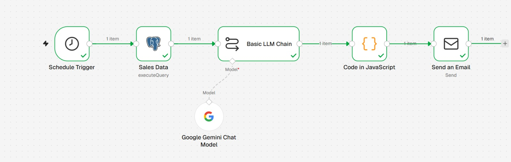
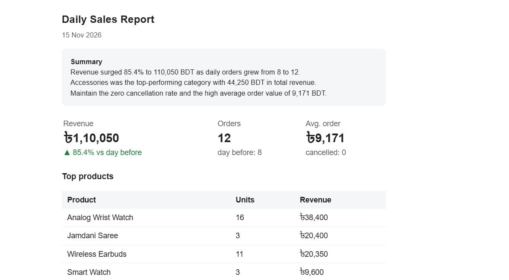

# AI Daily Sales Report — n8n + PostgreSQL + Gemini

Every morning at 9 AM, this workflow reads yesterday's sales from a database, has AI write a 3-line business summary, and emails the owner a clean, ready-to-read report — with no manual work.



## The problem

Small business owners spend 20–30 minutes every day pulling numbers from their sales system, comparing them with the day before and working out what sold best. Most of the time they skip it, and decisions are made without data.

## What this automation does

1. **Runs on a schedule** — every day at 9:00 AM (Asia/Dhaka)
2. **Pulls yesterday's sales** from PostgreSQL with one SQL query: revenue, orders, average order value, cancellations, top products, category and city breakdown
3. **Compares with the day before** and calculates the % change
4. **Writes an AI summary** (Google Gemini): the overall result, the best performer and one thing to act on — using only the real numbers
5. **Emails a formatted HTML report** to the owner



## Tech stack

| Part | Tool |
|---|---|
| Automation | n8n (self-hosted, Docker) |
| Database | PostgreSQL 16 |
| AI | Google Gemini (via n8n Basic LLM Chain) |
| Report | JavaScript (n8n Code node) → HTML email |
| Email | SMTP |

## Files

| File | What it is |
|---|---|
| `Daily_Sales_Report.json` | The n8n workflow (import into n8n) |
| `docker-compose.yml` | Starts n8n and PostgreSQL together |
| `init.sql` | Sample online-shop database: 12 products, ~1,000 orders over 60 days |
| `report.sql` | The report query (yesterday vs. day before) |
| `build_report.js` | Code node that builds the HTML email |

## Run it yourself

**Requirements:** Docker Desktop, a free Gemini API key, and an email account with SMTP access (for Gmail, an App Password).

1. Clone this repo and start everything:
   ```
   docker compose up -d
   ```
2. Open **http://localhost:5678** and create your n8n account.
3. Import the workflow: drag `Daily_Sales_Report.json` onto the n8n canvas.
4. Set up the three credentials:
   - **Postgres:** host `postgres`, database `shop`, user `shop`, password `shop123`, port `5432`
   - **Google Gemini:** your API key
   - **SMTP:** your email server details
5. In the **Send Email** node, set your own From/To address.
6. Click **Execute workflow** — the report arrives in your inbox.

To refresh the sample data (so "yesterday" always has sales):
```
docker compose exec postgres psql -U shop -d shop -f /docker-entrypoint-initdb.d/init.sql
```

> The sample password `shop123` is for local demos only.

## Adapting it for a real business

- **Other data sources:** swap the Postgres node for Google Sheets, MySQL, Shopify, WooCommerce or any REST API
- **Other channels:** send the summary to WhatsApp, Telegram or Slack instead of (or as well as) email
- **Other reports:** weekly/monthly summaries, low-stock alerts, or a report per branch

## About

Built by **Puja Dhar**, software engineer (C#/.NET, SQL, Python) who builds business automations with n8n.

Need something like this for your business? Get in touch on [LinkedIn](#).
